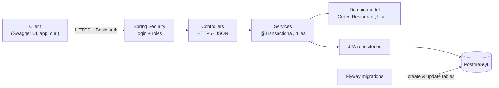
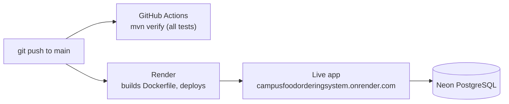

# CampusFood – Ordering API

[](https://github.com/ersinumutaslan/campusFoodOrderingSystem/actions/workflows/ci.yml)

Backend for a university cafeteria food-ordering system, built with **Java 25** and **Spring Boot 4**.
Students browse restaurants and menus, place orders and track them. Restaurant staff move orders
through the kitchen (placed → preparing → ready → completed).

**Live demo:** https://campusfoodorderingsystem.onrender.com — opens the interactive API docs (Swagger UI).
It runs on a free server that sleeps when unused, so the first visit can take about a minute.
Log in with one of the [demo users](#demo-users).

## What this project shows

- **REST API** with Spring Boot: controllers, services, repositories, request/response records
- **PostgreSQL** with **Spring Data JPA** (Hibernate) and versioned schema migrations with **Flyway**
- **Business rules in the domain model**: orders only accept available items from the restaurant's own menu;
  order status changes follow allowed transitions (a completed order cannot go back to the kitchen)
- **Validation** with Bean Validation and **consistent error responses** (RFC 9457 Problem Details)
- **Security** with Spring Security: login, roles (STUDENT / STAFF / ADMIN), students see only their own orders
- **Testing**: unit tests, web-layer tests with mocks, and integration tests against a real PostgreSQL
  started by **Testcontainers** (57 tests)
- **Docker**: multi-stage image, non-root user, Docker Compose for the full local stack
- **CI/CD**: GitHub Actions runs all tests on every push; Render deploys `main` automatically
- **API documentation** generated from the code with OpenAPI / Swagger UI

## Architecture



| Layer | Package | Responsibility |
|---|---|---|
| Web | `*.Controller` | Map HTTP requests to service calls; validate input |
| Service | `order.OrderService` | One transaction per use case; turn rule violations into 400/404/409 |
| Domain | `Order`, `OrderItem`, `OrderStatus`, `Restaurant`, `Product`, `User` | Business rules, independent of HTTP |
| Persistence | `*Repository` (Spring Data JPA) | Database access; SQL generated from method names |
| Cross-cutting | `common.SecurityConfig`, `common.GlobalExceptionHandler` | Access rules, one error format for the whole API |

Code is organized **by feature**: `restaurant/`, `order/`, `user/`, plus `common/` for shared configuration.

## Tech stack

Java 25 · Spring Boot 4.1 (Web MVC, Data JPA, Security, Validation) · Hibernate 7 · PostgreSQL 18 · Flyway ·
JUnit 5 · Mockito · Testcontainers · springdoc-openapi (Swagger UI) · Maven · Docker · GitHub Actions · Render · Neon

## API

Interactive docs: [`/swagger-ui.html`](https://campusfoodorderingsystem.onrender.com/swagger-ui.html)

| Method | Path | Who | Description |
|---|---|---|---|
| GET | `/restaurants` | everyone | List all restaurants |
| GET | `/restaurants/{id}/products` | everyone | Available menu of one restaurant (404 if unknown) |
| POST | `/orders` | STUDENT | Place an order for the logged-in student (201; 400 for invalid data or broken rules) |
| GET | `/orders/mine` | logged in | The logged-in user's orders, newest first |
| GET | `/orders/{id}` | logged in | One order; students only their own (403), staff and admins any |
| PATCH | `/orders/{id}/status` | STAFF | Move an order to a new status, e.g. `{"status": "PREPARING"}` (409 if not allowed) |

Example: placing an order as a student

```bash
curl -u ayse@campus.edu:campus123 -X POST https://campusfoodorderingsystem.onrender.com/orders \
  -H 'Content-Type: application/json' \
  -d '{"restaurantId": 1, "items": [{"productId": 1, "quantity": 2}]}'
```

Every error has the same shape:

```json
{ "status": 400, "title": "Bad Request", "detail": "Lentil Soup is not available", "instance": "/orders" }
```

## Demo users

Created by the Flyway migrations, all with the password `campus123`. They are public demo accounts with fake data.

| Email | Role |
|---|---|
| ayse@campus.edu | STUDENT |
| ali@campus.edu | STUDENT |
| mehmet@campus.edu | STAFF |
| zeynep@campus.edu | ADMIN |

Requests log in with email + password (HTTP Basic). In Swagger UI, use the **Authorize** button.

## Run locally

Requirements: Java 25, Maven 3.9+, Docker.

```bash
docker compose up -d       # start PostgreSQL on port 5433
mvn spring-boot:run        # start the API on http://localhost:8080
```

Flyway creates the tables and sample data on first start. Then open http://localhost:8080.

### Or run everything in Docker (no Java or Maven needed)

```bash
docker compose --profile app up -d --build   # build the app image, start database + app
docker compose --profile app down            # stop both (data is kept)
```

## Tests

```bash
mvn test
```

Docker must be running: the integration tests use Testcontainers to start a throwaway PostgreSQL 18.

| Kind | Examples | What they check |
|---|---|---|
| Unit | `OrderTest`, `OrderServiceTest` | Business rules and service logic, no Spring or database |
| Web layer | `OrderControllerTest`, `RestaurantControllerTest` | HTTP status codes, JSON, validation, security rules (mocked services) |
| Integration | `OrderFlowIntegrationTest` | The whole app against a real PostgreSQL: place an order, read it back, move it through the kitchen |

## CI/CD and deployment



- **CI**: [`.github/workflows/ci.yml`](.github/workflows/ci.yml) runs `mvn verify` on every push and pull request.
- **Hosting**: [Render](https://render.com) free web service (Frankfurt) builds the [`Dockerfile`](Dockerfile) and redeploys automatically when `main` changes.
- **Database**: [Neon](https://neon.com) free PostgreSQL (Frankfurt). Flyway applies the migrations on startup.
- **Configuration**: the database connection is set on Render as environment variables, never in the code:

| Variable | Example |
|---|---|
| `SPRING_DATASOURCE_URL` | `jdbc:postgresql://<neon-host>/neondb?sslmode=require` |
| `SPRING_DATASOURCE_USERNAME` | `neondb_owner` |
| `SPRING_DATASOURCE_PASSWORD` | *(secret, only in Render)* |

The app reads the port from `PORT` (set by Render) and uses up to 75% of the container memory, so it fits the 512 MB free instance.

## Project roadmap

1. Java and OOP: domain model and first tests ✅
2. PostgreSQL and SQL: schema, constraints, joins, transactions ✅
3. Spring Boot REST API: JPA, Flyway, validation ✅
4. Testing and security: error handling, Testcontainers, Spring Security ✅
5. Production: Docker, CI/CD, cloud deployment ✅
6. Advanced: logging, monitoring, caching, performance — *next*
7. Simple frontend for the demo — *later*
